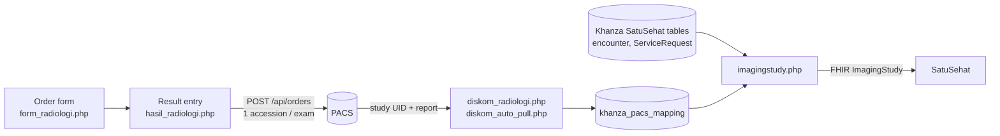

# SIMRS Radiology ↔ PACS ↔ SatuSehat

[](https://github.com/ArkFunDev/simrs-radio-pacs-satusehat/actions/workflows/lint.yml)

An add-on module for **SIMRS Khanza** (open-source hospital information system) that
connects radiology orders to a **PACS** (DICOM) and automatically submits **ImagingStudy**
resources to Indonesia's national health data platform **SatuSehat** (FHIR R4).

*Ringkasan (ID): modul tambahan SIMRS Khanza yang menghubungkan order radiologi → PACS →
SatuSehat Kemenkes, termasuk pengiriman ImagingStudy otomatis. Sudah berjalan di lingkungan
rumah sakit; repositori ini adalah versi yang sudah dibersihkan dari data pribadi/rahasia.*

> ⚠️ **Disclaimer:** community project, not an official SIMRS Khanza or Ministry of Health
> product. It handles medical data. Review the code and test it in **STAGING** before any
> production use.

## Status

| Item | State |
|---|---|
| Radiology order → PACS (accession per examination) | Working in a live hospital environment |
| Pull DICOM viewer link + radiologist report from PACS | Working (manual + cron) |
| ImagingStudy → SatuSehat (single and batch) | Working in a live hospital environment |
| Automated tests | Not yet (see [Roadmap](#roadmap)) |
| Public demo with synthetic data | Not yet (see [Roadmap](#roadmap)) |

No patient data, credentials or hospital identifiers are in this repository. All secrets
live in `config.local.php`, which is git-ignored.

## Why this exists

Many Indonesian hospitals run SIMRS Khanza but still enter radiology results by hand,
view images in a separate PACS, and submit (or skip) SatuSehat integration manually.
This module closes that loop with free/open-source components only.

## How it works



Details: [docs/flow.md](docs/flow.md). Security review and fixes: [docs/AUDIT.md](docs/AUDIT.md).

## Requirements

- PHP 8.0+ with `curl`, `pdo_mysql`, `mbstring`
- MySQL/MariaDB with a working SIMRS Khanza database **including Khanza's SatuSehat tables**
  (`satu_sehat_encounter`, `satu_sehat_servicerequest_radiologi`) — this module reads them
- A PACS exposing the order API (`/api/orders`, `/api/orders/{acc}/{mrn}`)
- SatuSehat credentials (Client ID/Secret, Organization ID) — start with **STAGING**

## Installation

```bash
git clone https://github.com/ArkFunDev/simrs-radio-pacs-satusehat.git
cd simrs-radio-pacs-satusehat

cp config.local.example.php config.local.php   # edit with your own values
chmod 600 config.local.php
mysql -u <user> -p <database> < schema.sql      # review first; back up your DB
```

Serve the folder with Apache/Nginx + PHP **over HTTPS**, then open `login.php`.
Set `TOKEN_CACHE_DIR` in `config.local.php` to a private folder outside the web root.

### Scheduled PACS pull (optional)

```bash
# every hour (cron)
0 * * * * php /path/to/diskom_auto_pull.php

# test one patient (verbose)
php diskom_auto_pull.php --no_rawat=2026/01/01/000001
```

## Project structure

| File | Purpose |
|---|---|
| `login.php`, `logout.php`, `index.php`, `auth_check.php` | Authentication, roles, main shell |
| `config.php` | Shared helpers (PACS, SatuSehat, utilities); loads `config.local.php` |
| `data_pasien.php`, `form_radiologi.php` | Patient list, create radiology request |
| `data_radiologi.php`, `DataPermintaanRadio.php` | Request lists and PACS submission |
| `hasil_radiologi.php` | Result entry, send to PACS |
| `periksa_radiologi.php`, `periksa_radiologi_user.php` | Examination lists |
| `diskom_radiologi.php`, `diskom_auto_pull.php` | Pull DICOM link and report from PACS |
| **`imagingstudy.php`** | **ImagingStudy → SatuSehat (single + batch, token auto-refresh)** |
| `form_imagingstudy.php` | Earlier manual form that also builds its own ServiceRequest payload |
| `schema.sql`, `docs/` | Database additions, workflow notes, audit |

## Security

Implemented: login with role checks (`require_role`), hardened session cookies, same-origin
check on every POST, CSRF token on the SatuSehat page, TLS verification on all outbound
requests, token cached server-side only (never sent to the browser), output escaping on the
result-entry page, errors logged instead of displayed.

Known limitations (tracked in [docs/AUDIT.md](docs/AUDIT.md)): per-form CSRF tokens on the
older pages, remaining unescaped output in some list pages, legacy accession scheme in
`DataPermintaanRadio.php`. Deploy behind HTTPS on the hospital network/VPN. Report
vulnerabilities as described in [SECURITY.md](SECURITY.md).

## Roadmap

- [ ] Docker Compose demo: PHP + MariaDB + Orthanc (open-source PACS) + synthetic data
- [ ] Real DICOM series/instance UIDs and `numberOfSeries/Instances` in ImagingStudy
- [ ] Unit tests for accession, payload builders and token cache
- [ ] Per-form CSRF tokens on all pages; remove the legacy order path
- [ ] English UI strings (i18n)

## Contributing

Issues and pull requests are welcome. Never include real patient data, credentials or
hospital-identifying information in issues or PRs.

## License

MIT. See [LICENSE](LICENSE).
